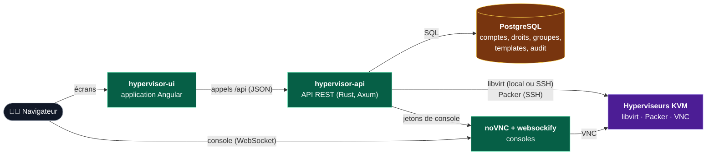
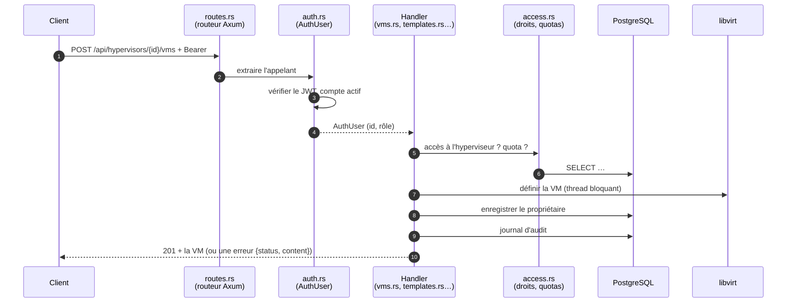
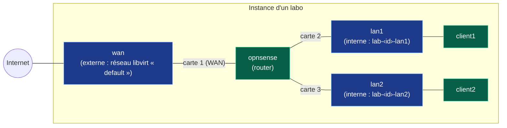

# Architecture

Comment le projet fonctionne dans son ensemble, puis comment ce dépôt (`hypervisor-api`) est
organisé.

- Les appels de l'API, route par route : [API.md](API.md).
- Les conteneurs, ports et réseaux Docker : [DOCKER.md](DOCKER.md).
- Les comptes, rôles et droits en détail : [AUTH.md](AUTH.md).

## 1. Fonctionnement global

### Les briques



| Brique | Rôle |
|---|---|
| **Interface** (`hypervisor-ui`) | Affiche les écrans et appelle l'API. Ne parle jamais aux hyperviseurs, ne garde aucune donnée. |
| **API** (ce dépôt) | Vérifie qui appelle et ce qu'il a le droit de faire, pilote les hyperviseurs par libvirt, garde ce que libvirt ne sait pas dans PostgreSQL, et ouvre les consoles. |
| **PostgreSQL** | La base de l'API. |
| **noVNC + websockify** | Affiche la console d'une VM dans le navigateur, en relayant son flux VNC. |
| **Hyperviseurs** | Des machines Linux avec KVM et libvirt, jointes en local (`qemu:///system`) ou par SSH (`qemu+ssh://…`). |

### Qui garde quoi

L'API ne recopie pas l'état des machines : **libvirt reste la source de vérité** pour les
VM, les disques, les pools et les réseaux. Chaque liste de VM est lue en direct sur
l'hyperviseur. La base ne garde que ce que libvirt ignore :

| Dans PostgreSQL | Dans libvirt (sur l'hyperviseur) |
|---|---|
| Hyperviseurs enregistrés (nom, URI) | VM : définition, état, mémoire, processeurs |
| Comptes, sessions, quotas, réglages | Disques (volumes) et pools de stockage |
| Accès aux hyperviseurs, groupes | Réseaux virtuels |
| **Propriétaire** de chaque VM (par son UUID libvirt), prêts | Ports VNC des consoles |
| Templates, leurs versions et logs de build, droits sur les templates | Disques construits par Packer |
| Labos (réseaux, VM, câblage), droits sur les labos, instances déployées | Réseaux internes et VM des instances |
| Jetons de console, journal d'audit | |

Une VM créée hors de l'API (avec `virsh`, par exemple) apparaît donc aussi, mais sans
propriétaire : seuls les admins la voient, jusqu'à ce qu'un admin la donne à quelqu'un.

### Le chemin d'une requête dans l'API



1. **Le routeur** (`routes.rs`) associe le chemin à une fonction (un *handler*).
2. **L'appelant** est extrait par `AuthUser` (`auth.rs`) : le jeton JWT est vérifié, et le
   compte doit exister et être actif. Sans jeton valide, la requête s'arrête en `401`.
3. **Le handler** vérifie les droits avec `access.rs` (rôle, accès à l'hyperviseur,
   propriétaire, prêt, quota, droits sur un template). Sans droit sur une ressource, il
   répond `404`, comme si elle n'existait pas.
4. **libvirt** est appelé dans un thread à part (`spawn_blocking`) : sa bibliothèque est
   bloquante, et un hyperviseur lent ne doit pas figer l'API.
5. **Les erreurs** de toutes sortes sont converties en une réponse unique
   `{"status":"error","content":"…"}` par `errors.rs`.
6. **Les actions** qui changent quelque chose sont inscrites dans le journal d'audit
   (`audit.rs`).

### Les droits, en bref

- Deux rôles : **admin** (tout) et **user**.
- Un utilisateur crée des VM sur les hyperviseurs auxquels un admin lui a donné **accès**,
  dans la limite de son **quota** (VM, processeurs, mémoire, disque).
- Il **possède** les VM qu'il crée. Il peut les **prêter** (console, démarrage, arrêt), et un
  admin peut les **donner** à quelqu'un d'autre.
- Les **groupes** (qui peuvent contenir des groupes) servent à donner des **droits sur les
  templates** : `use` (créer des VM, avec un maximum par personne) ou `manage` (modifier et
  reconstruire), et des **droits sur les labos** sur le même modèle (`use` : déployer ses
  instances, avec un maximum par personne ; `manage` : modifier le labo et piloter toutes
  ses instances).

Le détail est dans [AUTH.md](AUTH.md).

### Les opérations longues

Cloner une VM ou en créer une depuis un template prend du temps (copie de disques). L'API
répond tout de suite `202` avec une **tâche**, et fait le travail en arrière-plan
(`jobs.rs`). Le client suit la tâche avec `GET /api/jobs/{id}`. Les ressources que la tâche
va consommer sont réservées dès le départ : deux demandes simultanées ne peuvent pas
dépasser un quota. Les tâches sont gardées en mémoire et perdues au redémarrage.

### Les templates

Un template est une **configuration Packer**. Construire un template (`templates.rs`) :

1. crée une nouvelle **version** numérotée dans la base, en `pending` ;
2. attend une place (2 builds au plus en même temps), puis passe en `in_progress` ;
3. lance Packer **sur l'hyperviseur**, par SSH (ou sur la machine de l'API pour un
   hyperviseur local) ; sa sortie est enregistrée comme **log**, lisible en direct ;
4. copie le disque construit dans un pool libvirt : la version passe en `created`
   (ou `failed`, ou `cancelled` si on l'arrête).

Créer une VM depuis un template copie le disque de la version, puis définit la VM. Un build
interrompu par un redémarrage de l'API est marqué `failed` à la première requête sur les
templates qui suit.

### Les labos

Un labo (`labs.rs`) est une **définition** : des réseaux et des VM issues de templates, chacune
avec ses cartes réseau dans l'ordre.



**Déployer** un labo crée une **instance**, en arrière-plan (`202`) :

1. la place est vérifiée sous verrou : quota de l'utilisateur pour **toutes** les VM du labo,
   et `max_instances` ; l'instance est enregistrée en `deploying`, et ses ressources sont
   réservées par une tâche ;
2. chaque réseau **interne** est créé sur l'hyperviseur (réseau isolé `lab-‹id›-‹nom›`) ; les
   réseaux **externes** sont des réseaux libvirt existants, partagés ;
3. chaque VM est créée depuis le disque de son template (copie), avec ses cartes branchées
   dans l'ordre, les **routeurs d'abord** ; elle appartient à celui qui déploie ;
4. si demandé, les VM sont démarrées (routeurs d'abord) ; l'instance passe en `ready`.

Si une étape échoue, tout ce qui a été créé est supprimé et l'instance passe en `failed`,
avec la raison. Les VM d'une instance sont des VM ordinaires de leur propriétaire : les routes
des VM (console, démarrage, arrêt) marchent dessus. Supprimer l'instance supprime ses VM,
leurs disques et ses réseaux internes.

L'API ne configure pas les routeurs : un OPNsense reçoit ses cartes dans l'ordre (la
première = WAN) ; ses adresses et son DHCP viennent de son template, ou se règlent dans sa
console.

### Les consoles

1. Le client demande `GET …/vms/{vm_id}/vnc`. L'API vérifie le droit sur la VM et lit son
   port VNC dans libvirt.
2. Elle crée un **jeton aléatoire** valable 2 minutes (table `vnc_tokens`), et réécrit le
   fichier `vm.cfg` (`jeton: hôte:port`) que lit websockify.
3. Elle renvoie `novnc_url`. Le navigateur ouvre noVNC, qui se connecte à websockify avec
   le jeton ; websockify relaie le flux vers le port VNC de la VM.

Une tâche de fond retire les jetons expirés du fichier (`vnc.rs`).

### Le démarrage de l'API

`main.rs`, dans l'ordre :

1. lit la configuration (variables d'environnement, `config.rs`) ;
2. se connecte à PostgreSQL (`DATABASE_URL`) et applique les migrations de `migrations/` ;
3. crée le premier administrateur si la base n'a aucun compte (`ADMIN_USERNAME`,
   `ADMIN_PASSWORD`) ;
4. réécrit le fichier des jetons de console, et lance son nettoyage périodique ;
5. monte les routes, Swagger (`/swagger-ui`) et le CORS si `CORS_ALLOWED_ORIGINS` est
   rempli ;
6. écoute sur le port 3000.

## 2. Organisation du dépôt

```text
hypervisor-api/
├── src/                      Code de l'API (Rust) — détail ci-dessous
├── migrations/
│   ├── 0001_init.sql         Schéma PostgreSQL de départ
│   └── 0002_labs.sql         Tables des labos (appliquées au démarrage, dans l'ordre)
├── docs/                     Documentation technique
│   ├── API.md                Référence des routes
│   ├── ARCHITECTURE.md       Ce document
│   ├── AUTH.md               Comptes, rôles, droits, quotas, branchement du front
│   ├── DOCKER.md             Conteneurs, ports, réseaux (API + interface), schémas
│   ├── HAPROXY.md            HTTPS : certificats, HAProxy, dépannage
│   ├── BRUNO.md              Utiliser la collection Bruno
│   └── bruno/                Collection Bruno : une requête par route, par thème
│       ├── 00-Auth/ … 12-Labs/
│       ├── environments/     local.bru, remote-kvm.bru
│       └── check-sync.sh     Vérifie que la collection couvre toute l'OpenAPI
├── haproxy/                  Configuration des HAProxy (HTTPS)
│   ├── common.cfg            Commun : TLS, délais, redirection HTTP → HTTPS
│   ├── api.cfg               Entrée de l'API (:8443 public, :9443 interne pour le front)
│   └── novnc.cfg             Entrée des consoles (:6443)
├── scripts/
│   └── sqlite-to-postgres.sh Reprend les données d'une ancienne base SQLite
├── docker/
│   ├── novnc-entrypoint.sh   Démarrage de websockify avec le fichier de jetons
│   └── Dockerfile            Ancienne image noVNC (non utilisée : voir Dockerfile.novnc)
├── .github/workflows/
│   ├── cd.yml                Construit et publie l'image de l'API sur Docker Hub
│   └── cd-novnc.yml          Pareil pour l'image noVNC
├── Cargo.toml, Cargo.lock    Dépendances Rust
├── Dockerfile                Image de l'API (compilation Rust, puis Debian minimal)
├── Dockerfile.novnc          Image noVNC + websockify
├── docker-compose.yml        API, PostgreSQL, noVNC et leurs deux HAProxy
├── .env.example              Modèle de configuration (à copier en .env)
├── README.md                 Présentation et fonctionnalités
├── DEPLOY.md                 Installation rapide (API, noVNC, interface)
├── INSTALLATION.md           Installation détaillée (développement et Docker)
└── TOOLS.md                  Outils de développement
```

Non versionnés (ignorés par git) : `.env` (secrets), `tls/` (certificat et clé), `target/`
(compilation), `data/` (ancienne base SQLite).

### Le code (`src/`)

Un fichier par domaine. Chaque fichier de handlers contient ses routes, ses modèles
d'entrée et de sortie, ses requêtes SQL et ses tests.

**Démarrage et socle**

| Fichier | Rôle |
|---|---|
| `main.rs` | Point d'entrée : configuration, base, premier admin, serveur (voir [plus haut](#le-démarrage-de-lapi)). |
| `config.rs` | Lit les variables d'environnement une fois au démarrage (durées des jetons, origines CORS, fichier des jetons noVNC…). |
| `state.rs` | `AppState`, partagé par toutes les requêtes : connexion à PostgreSQL, tâches, configuration, verrous. |
| `routes.rs` | La table des routes : chemin + méthode → handler. |
| `docs.rs` | Déclare chaque route et chaque modèle pour l'OpenAPI et Swagger. |
| `errors.rs` | `ApiError` : toutes les erreurs et le code HTTP de chacune, en `{"status","content"}`. |
| `models.rs` | Modèles partagés : hyperviseur, VM, disques, réseaux, pools, message. |
| `common.rs` | `/ping` et petites aides communes. |

**Comptes et droits**

| Fichier | Rôle |
|---|---|
| `auth.rs` | Mots de passe (argon2), jetons JWT, refresh tokens, et l'extracteur `AuthUser` (qui appelle ?). |
| `users.rs` | Connexion, inscription, comptes, quotas, réglages, premier administrateur. |
| `access.rs` | **Qui peut faire quoi** : accès aux hyperviseurs, propriétaire et prêt des VM, quotas. |
| `groups.rs` | Groupes et sous-groupes, appartenance (y compris par un sous-groupe). |
| `shares.rs` | Prêter une VM, retirer un prêt, changer le propriétaire. |
| `audit.rs` | Écrit et lit le journal d'audit. |

**Hyperviseurs et machines**

| Fichier | Rôle |
|---|---|
| `hypervisors.rs` | Enregistrer, modifier, supprimer un hyperviseur ; accès des utilisateurs. |
| `libvirt.rs` | Appels à libvirt : lister les VM, les options de création, créer une VM. |
| `vms.rs` | Routes des VM : lister, créer, démarrer, arrêter, cloner, supprimer. |
| `vm_create.rs` | Vérifie une demande de création de VM avant de toucher à libvirt. |
| `vm_options.rs` | Ce qu'on peut choisir pour créer une VM sur un hyperviseur (pools, volumes, réseaux, limites). |
| `vm_xml.rs` | Construit et lit le XML libvirt des VM et des disques. |
| `infrastructure.rs` | Disques, pools de stockage et réseaux. |
| `jobs.rs` | Les tâches en arrière-plan, gardées en mémoire. |
| `templates.rs` | Templates Packer : définitions, versions, builds (en SSH), logs, droits, création de VM. |
| `labs.rs` | Labos : réseaux, VM et câblage, droits, déploiement des instances (réseaux internes, VM), démarrage, arrêt, suppression. |
| `vnc.rs` | Jetons de console et fichier lu par websockify. |

**Tests**

| Fichier | Rôle |
|---|---|
| `http_tests.rs` | `TestApp` : une API complète pour les tests, avec sa base (un schéma PostgreSQL neuf par test) et un hyperviseur de test (`test:///default`, en mémoire). Tests HTTP des VM. |
| `auth_tests.rs` | Tests de l'authentification, des rôles, des prêts, des quotas et de l'audit. |
| *(dans chaque module)* | Des tests `#[cfg(test)]` au bas des fichiers (groupes, templates, VM…). |

Les tests n'utilisent aucun vrai hyperviseur. Ils ont besoin d'un PostgreSQL jetable
(`TEST_DATABASE_URL`, voir [INSTALLATION.md](../INSTALLATION.md#5-tests-et-qualité)).

### Ajouter une route

1. Écrire le handler dans le fichier de son domaine, avec son annotation
   `#[utoipa::path(...)]` (méthode, chemin, corps, codes de réponse).
2. Le brancher dans `routes.rs`.
3. Le déclarer, avec ses modèles, dans `docs.rs` (Swagger).
4. Si la base change : ajouter une migration `migrations/000N_….sql` (ne jamais modifier une
   migration déjà appliquée).
5. Écrire ses tests, avec `TestApp`.
6. Ajouter sa requête dans `docs/bruno/`, puis lancer `docs/bruno/check-sync.sh`.
7. La documenter dans [API.md](API.md).
8. Avant de commiter : `cargo fmt --check`, `cargo clippy --all-targets --all-features -- -D warnings`, `cargo test`.
