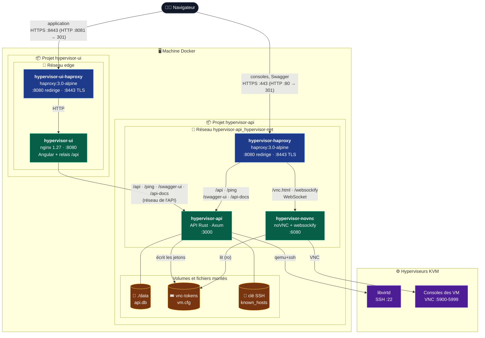
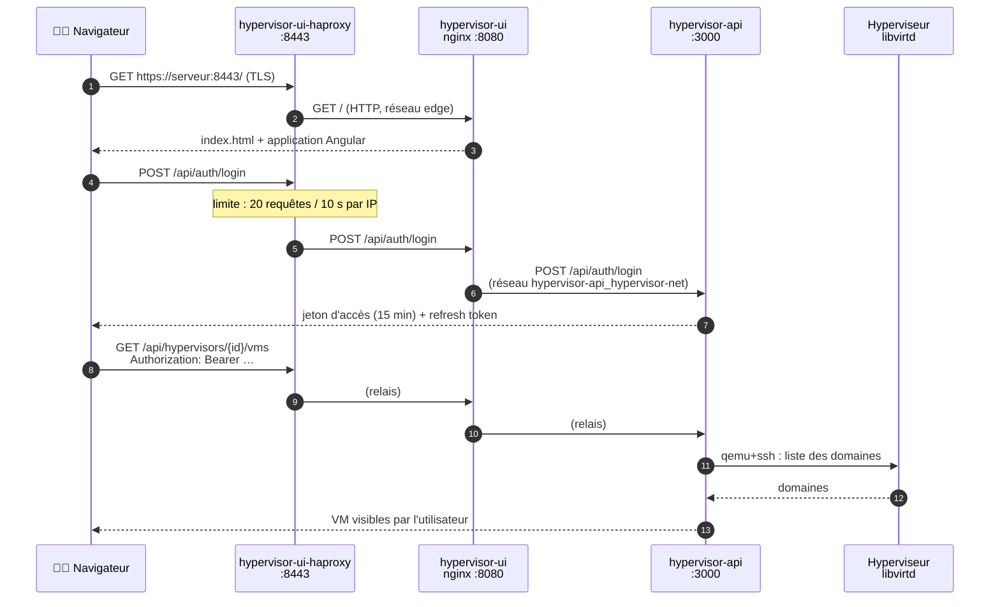
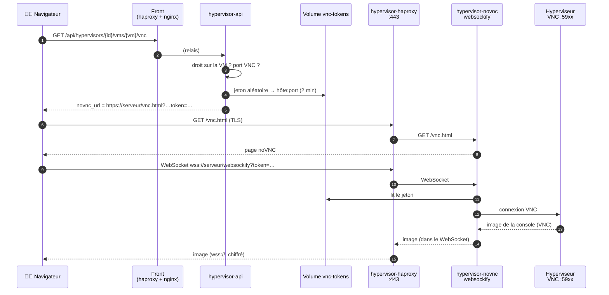

# Fonctionnement avec Docker : API et frontend

Ce document explique comment l'API (ce dépôt, `hypervisor-api`) et le frontend Angular
(dépôt `hypervisor-ui`) tournent ensemble dans Docker : les conteneurs, les ports, les
réseaux, les volumes, et le chemin que suit une requête.

Pour les commandes d'installation pas à pas, voir [INSTALLATION.md](../INSTALLATION.md).

## En bref

- **Deux projets Docker Compose**, lancés chacun depuis son dépôt :
  - `hypervisor-api` : `haproxy` → `api` + `novnc` ;
  - `hypervisor-ui` : `haproxy` → `ui` (nginx, qui sert l'application et relaie `/api`).
- **Un réseau Docker les relie** : le réseau de l'API, `hypervisor-api_hypervisor-net`. Le
  conteneur du front s'y branche pour joindre l'API sous le nom `api`.
- **Deux portes d'entrée HTTPS**, une par projet :
  - le **front** sur `https://<serveur>:8443` : l'application, et l'API à travers elle ;
  - l'**API** sur `https://<serveur>` (443) : les consoles noVNC, Swagger, l'API en direct.
- **Rien d'autre n'est publié** : ni noVNC, ni nginx. L'API n'est ouverte que sur
  `127.0.0.1:3000`, pour les outils locaux (Bruno, curl).

## Schéma d'ensemble



Le conteneur `hypervisor-ui` est branché sur **deux** réseaux : `edge` (avec le HAProxy du
front) et celui de l'API (pour joindre `api:3000`). Les ports `8443` et `8081` du front sont
ceux de son `.env`. Ils doivent être différents de ceux de l'API (`443` et `80`), puisque les
deux HAProxy tournent sur la même machine.

## Les conteneurs

| Conteneur | Projet | Image | Port dans le conteneur | Publié sur la machine | Réseaux |
|---|---|---|---|---|---|
| `hypervisor-haproxy` | api | `haproxy:3.0-alpine` | 8080, 8443 | `80` → 8080, `443` → 8443 | `hypervisor-api_hypervisor-net` |
| `hypervisor-api` | api | `remi/hypervisor-api` (construite depuis `Dockerfile`) | 3000 | `127.0.0.1:3000` seulement | `hypervisor-api_hypervisor-net` |
| `hypervisor-novnc` | api | `remi/hypervisor-novnc` (`Dockerfile.novnc`) | 6080 | non | `hypervisor-api_hypervisor-net` |
| `hypervisor-ui-haproxy` | ui | `haproxy:3.0-alpine` | 8080, 8443 | `HTTP_PORT` → 8080, `HTTPS_PORT` → 8443 | `edge` |
| `hypervisor-ui` | ui | `remialban/hypervisor-ui` (`Dockerfile`, étape `web`) | 8080 | non | `edge` + `hypervisor-api_hypervisor-net` |
| `hypervisor-ui-mock` *(option)* | ui | `hypervisor-ui-mock` (étape `mock`) | 3000 | non | `default` du projet ui |

Les deux HAProxy écoutent sur 8080 et 8443 **dans** leur conteneur. C'est Compose qui les
relie aux ports de la machine : aucun conteneur n'a besoin des droits root pour ouvrir un
port inférieur à 1024.

### Rôle de chacun

- **`hypervisor-haproxy`** (configuration : [haproxy/haproxy.cfg](../haproxy/haproxy.cfg)).
  Il termine le TLS avec le certificat de l'API (`TLS_CERT_PATH` et `TLS_KEY_PATH`) et
  aiguille par chemin : `/api/…`, `/ping`, `/swagger-ui…` et `/api-docs/…` vers `api:3000`,
  tout le reste vers `novnc:6080`. Il limite `/api/auth/…` à 20 requêtes / 10 s par IP, et
  ajoute HSTS et `Referrer-Policy: no-referrer`. Une console WebSocket peut rester inactive
  jusqu'à 1 h. Détails : [HAPROXY.md](HAPROXY.md).
- **`hypervisor-api`**. Il :
  - garde les comptes, droits, groupes, templates et le journal dans `./data/api.db` ;
  - pilote les hyperviseurs avec libvirt : en `qemu+ssh` avec la clé SSH montée, ou par
    le socket local `/var/run/libvirt/libvirt-sock` ;
  - écrit les jetons de console dans le volume `vnc-tokens`.
- **`hypervisor-novnc`**. websockify sert les pages de noVNC et convertit le WebSocket du
  navigateur en connexion VNC vers l'hyperviseur. Il lit le volume `vnc-tokens` en lecture
  seule : il ne voit ni la base ni les comptes.
- **`hypervisor-ui-haproxy`**. C'est la même configuration de TLS que celle de l'API, avec
  le certificat du front. Il envoie tout à `ui:8080` et vérifie la santé de nginx (pas celle
  de l'API) : le site reste affiché même si l'API est arrêtée.
- **`hypervisor-ui`**. nginx sert l'application Angular compilée. Il renvoie `index.html`
  pour les routes Angular et met les fichiers `.js` et `.css` en cache un an. Il relaie
  `/api/…`, `/ping`, `/swagger-ui…` et `/api-docs/…` vers `API_UPSTREAM` (`http://api:3000`).
- **`hypervisor-ui-mock`** *(seulement avec `docker-compose.mock.yml`)*. C'est une fausse API
  en Node, pour développer le front sans hyperviseur : nginx l'appelle à la place de la
  vraie (`API_UPSTREAM=http://mock:3000`).

## Les réseaux

| Réseau | Créé par | Qui s'y branche | À quoi il sert |
|---|---|---|---|
| `hypervisor-api_hypervisor-net` | projet api (`hypervisor-net`) | les 3 conteneurs de l'API, et `hypervisor-ui` | HAProxy → API / noVNC, et front → API |
| `hypervisor-ui_edge` | projet ui (`edge`) | `hypervisor-ui-haproxy`, `hypervisor-ui` | HAProxy du front → nginx |
| `hypervisor-ui_default` *(option mock)* | projet ui | `hypervisor-ui`, `hypervisor-ui-mock` | nginx → fausse API |

Ce qu'il faut retenir :

- **Le réseau de l'API est `external` pour le front.** Le Compose du front ne le crée pas :
  il s'y branche (`API_NETWORK=hypervisor-api_hypervisor-net`). L'API doit donc être lancée
  **avant** le front, sinon `docker compose up` du front échoue avec `network … not found`.
- **Son nom vient du dossier** de l'API : `<dossier>_hypervisor-net`. Si le dépôt de l'API
  est cloné dans un dossier qui ne s'appelle pas `hypervisor-api`, il faut changer
  `API_NETWORK` dans le `.env` du front.
- **Le nom `api` se résout par le DNS de Docker** (`127.0.0.11`) dans ce réseau. C'est le
  nom du service de l'API dans son Compose : `API_UPSTREAM=http://api:3000`.
- **Les deux HAProxy n'ont aucun lien direct.** Le front parle à l'API par le réseau Docker,
  sans passer par le HAProxy de l'API.

## Les volumes et les fichiers montés

| Source sur la machine | Monté dans | En | Contenu |
|---|---|---|---|
| `./data` (api) | `api:/data` | lecture-écriture | `api.db` : comptes, groupes, droits, propriétaires de VM, templates, audit |
| volume `hypervisor-api_vnc-tokens` | `api:/vnc` et `novnc:/vnc` | rw pour l'API, **ro** pour noVNC | `vm.cfg` : `jeton: hôte:port` des consoles ouvertes |
| `SSH_PRIVATE_KEY_HOST_PATH` | `api:/root/.ssh/id_ed25519` | ro | clé SSH vers les hyperviseurs |
| `~/.ssh/known_hosts` | `api:/root/.ssh/known_hosts` | ro | empreintes des hyperviseurs |
| `/var/run/libvirt/libvirt-sock` | `api` | — | libvirt local (hyperviseur `qemu:///system`) |
| `TLS_CERT_PATH`, `TLS_KEY_PATH` (api) | `hypervisor-haproxy` | ro | certificat et clé de l'API |
| `TLS_CERT_PATH`, `TLS_KEY_PATH` (ui) | `hypervisor-ui-haproxy` | ro | certificat et clé du front |

Les montages de certificats et de clés SSH utilisent `create_host_path: false`. Un chemin
faux fait échouer le démarrage avec `bind source path does not exist`, au lieu que Docker
crée un dossier vide à sa place.

## Le chemin d'une requête

### Utiliser l'application

Le navigateur ne parle qu'au front. Les appels à l'API sont faits sur la **même origine**
(`/api/…`), donc il n'y a pas de CORS à configurer (`CORS_ALLOWED_ORIGINS` reste vide).



### Ouvrir une console

La console ne passe **pas** par le front. L'API renvoie une adresse noVNC construite avec
`NOVNC_URL` (le HAProxy de l'API), et le navigateur l'ouvre directement.



## Ports à retenir

| Sur la machine | Conteneur | Usage |
|---|---|---|
| `443` | `hypervisor-haproxy` | API en HTTPS, Swagger, **consoles noVNC** |
| `80` | `hypervisor-haproxy` | redirige vers `https://…:443` |
| `8443` (`HTTPS_PORT` du front) | `hypervisor-ui-haproxy` | **l'application** en HTTPS |
| `8081` (`HTTP_PORT` du front) | `hypervisor-ui-haproxy` | redirige vers `https://…:8443` |
| `127.0.0.1:3000` | `hypervisor-api` | API en HTTP, depuis la machine seulement (Bruno, curl) |
| *(aucun)* | `hypervisor-novnc`, `hypervisor-ui` | joignables seulement par leur HAProxy |

Côté hyperviseurs, la machine Docker doit pouvoir joindre le port **22** (SSH, pour libvirt et
Packer) et les ports **5900-5999** (VNC des VM, pour noVNC).

## Les variables qui relient les deux projets

| Variable | Fichier | Valeur | Pourquoi |
|---|---|---|---|
| `API_NETWORK` | `.env` du front | `hypervisor-api_hypervisor-net` | le réseau de l'API auquel le front se branche |
| `API_UPSTREAM` | `.env` du front | `http://api:3000` | où nginx relaie `/api` |
| `HTTP_PORT` / `HTTPS_PORT` | `.env` du front | `8081` / `8443` | ne pas entrer en conflit avec les `80` / `443` de l'API |
| `NOVNC_URL` | `.env` de l'API | `https://<serveur>/vnc.html` | l'adresse des consoles donnée au navigateur : le HAProxy de l'API |
| `CORS_ALLOWED_ORIGINS` | `.env` de l'API | vide | le front appelle l'API par sa propre origine, à travers nginx |

## Démarrer, arrêter

L'ordre compte : **l'API d'abord**, puisqu'elle crée le réseau que le front utilise.

```bash
# 1. L'API (crée le réseau hypervisor-api_hypervisor-net)
cd hypervisor-api
docker compose up -d --build --remove-orphans

# 2. Le front (s'y branche)
cd ../hypervisor-ui
docker compose up -d --build

# Vérifier
docker ps --format 'table {{.Names}}\t{{.Ports}}\t{{.Networks}}'
docker network inspect hypervisor-api_hypervisor-net \
  --format '{{range .Containers}}{{.Name}} {{end}}'   # doit lister hypervisor-ui
```

Pour arrêter, faites l'inverse : le front d'abord (`docker compose down` dans
`hypervisor-ui`), puis l'API. Tant qu'un conteneur du front y est branché, Docker refuse de
supprimer le réseau de l'API.

Sans la vraie API, pour travailler sur le front seul (fausse API, aucun réseau externe) :

```bash
cd hypervisor-ui
docker compose -f docker-compose.yml -f docker-compose.mock.yml up -d --build
```

## Points d'attention

- **Deux origines, donc deux certificats à accepter** avec un certificat auto-signé :
  `https://serveur:8443` (front) et `https://serveur` (API, consoles). Si l'avertissement n'a
  jamais été accepté sur le port 443, la console noVNC ne s'ouvre pas. Un même certificat
  (même nom, même IP) peut servir aux deux projets.
- **La limite sur l'authentification existe des deux côtés.** Les connexions faites par le
  front passent par nginx, qui parle directement à `api:3000` : le HAProxy de l'API ne les
  voit pas. Le HAProxy du front applique donc sa propre limite (20 requêtes / 10 s par IP).
  L'API, elle, bloque un compte 15 minutes après 5 mots de passe faux, quel que soit le
  chemin.
- **À l'intérieur de Docker, le trafic est en HTTP clair** (HAProxy → nginx → API, HAProxy →
  noVNC). Il ne quitte pas la machine. Le TLS s'arrête à chaque HAProxy.
- **Le trajet noVNC → hyperviseur n'est pas chiffré, et le port VNC des VM n'a pas de mot de
  passe.** Filtrez les ports 5900-5999 de l'hyperviseur pour qu'ils ne soient joignables que
  depuis la machine Docker (voir [HAPROXY.md](HAPROXY.md#ce-que-haproxy-ne-couvre-pas)).
- **Le nom `api` est générique.** Si un autre conteneur du réseau
  `hypervisor-api_hypervisor-net` portait aussi l'alias `api`, nginx pourrait l'atteindre à
  la place. Ne branchez sur ce réseau que les conteneurs de ces deux projets.
