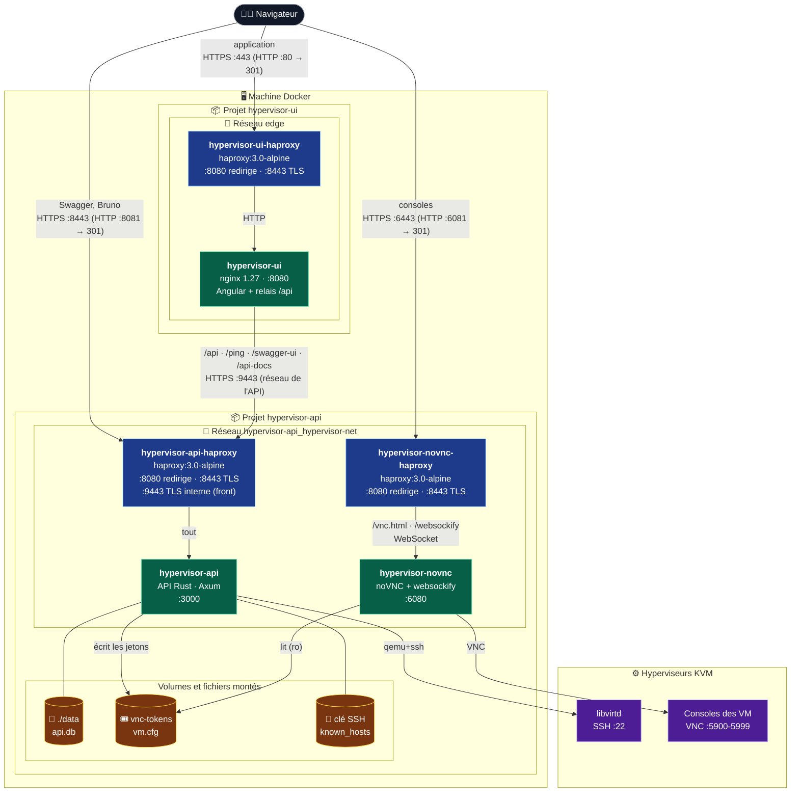
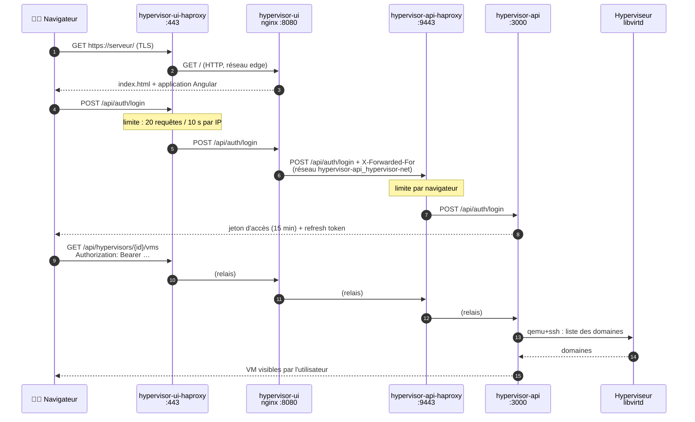
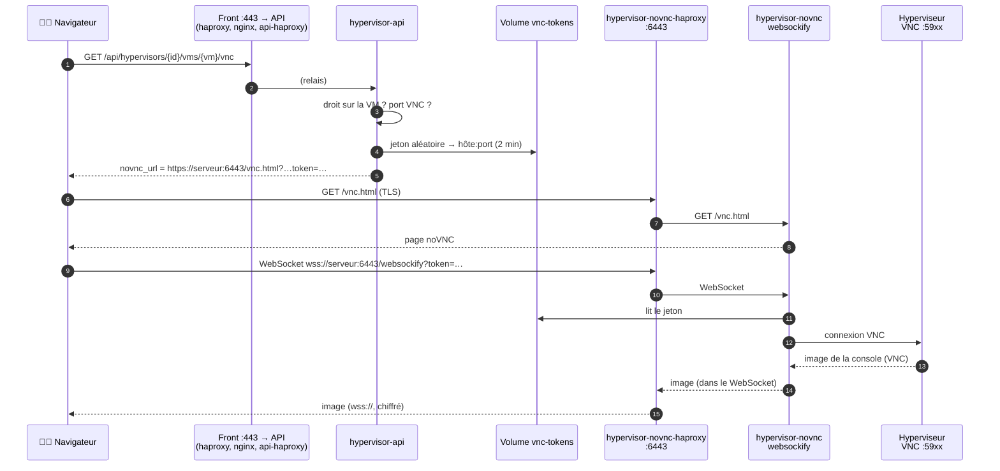

# Fonctionnement avec Docker : API et frontend

Ce document explique comment l'API (ce dépôt, `hypervisor-api`) et le frontend Angular
(dépôt `hypervisor-ui`) tournent ensemble dans Docker : les conteneurs, les ports, les
réseaux, les volumes, et le chemin que suit une requête.

Pour les commandes d'installation pas à pas, voir [INSTALLATION.md](../INSTALLATION.md).

## En bref

- **Deux projets Docker Compose**, lancés chacun depuis son dépôt :
  - `hypervisor-api` : `api`, `novnc`, et un HAProxy pour chacun des deux ;
  - `hypervisor-ui` : `ui` (nginx, qui sert l'application et relaie `/api`) et son HAProxy.
- **Trois portes d'entrée HTTPS**, une par HAProxy, chacune sur ses ports :

  | Entrée | HTTPS | HTTP (redirigé) | Pour quoi |
  |---|---|---|---|
  | frontend | **443** | **80** | l'application (et l'API à travers elle) |
  | API | 8443 | 8081 | Swagger, Bruno, scripts : l'API en direct |
  | noVNC | 6443 | 6081 | les consoles des VM |

- **Un réseau Docker relie les deux projets** : celui de l'API,
  `hypervisor-api_hypervisor-net`. Le conteneur du front s'y branche pour joindre le
  **HAProxy de l'API** sur son entrée interne `api-haproxy:9443` (non publiée) : toutes les
  requêtes vers l'API, celles du front comme celles de Swagger, passent par lui.
- **Rien d'autre n'est publié** : ni noVNC, ni nginx. L'API n'est ouverte que sur
  `127.0.0.1:3000`, pour les outils locaux (Bruno, curl).

## Schéma d'ensemble



Le conteneur `hypervisor-ui` est branché sur **deux** réseaux : `edge` (avec le HAProxy du
front) et celui de l'API (pour joindre `api-haproxy:9443`). Il ne parle jamais au conteneur
`api` directement.

## Les conteneurs

| Conteneur | Projet | Image | Port dans le conteneur | Publié sur la machine | Réseaux |
|---|---|---|---|---|---|
| `hypervisor-ui-haproxy` | ui | `haproxy:3.0-alpine` | 8080, 8443 | `80` → 8080, `443` → 8443 | `edge` |
| `hypervisor-ui` | ui | `remialban/hypervisor-ui` (`Dockerfile`, étape `web`) | 8080 | non | `edge` + `hypervisor-api_hypervisor-net` |
| `hypervisor-api-haproxy` | api | `haproxy:3.0-alpine` | 8080, 8443 | `8081` → 8080, `8443` → 8443 | `hypervisor-api_hypervisor-net` |
| `hypervisor-api` | api | `remi/hypervisor-api` (`Dockerfile`) | 3000 | `127.0.0.1:3000` seulement | `hypervisor-api_hypervisor-net` |
| `hypervisor-novnc-haproxy` | api | `haproxy:3.0-alpine` | 8080, 8443 | `6081` → 8080, `6443` → 8443 | `hypervisor-api_hypervisor-net` |
| `hypervisor-novnc` | api | `remi/hypervisor-novnc` (`Dockerfile.novnc`) | 6080 | non | `hypervisor-api_hypervisor-net` |
| `hypervisor-ui-mock` *(option)* | ui | `hypervisor-ui-mock` (étape `mock`) | 3000 | non | `default` du projet ui |

Les trois HAProxy écoutent sur 8080 et 8443 **dans** leur conteneur. C'est Compose qui les
relie à des ports différents de la machine : aucun conteneur n'a besoin des droits root
pour ouvrir un port inférieur à 1024.

### Rôle de chacun

- **`hypervisor-ui-haproxy`** (dépôt ui, `haproxy/haproxy.cfg`). Il termine le TLS avec le
  certificat du front et envoie tout à `ui:8080`. Il limite `/api/auth/…` à 20 requêtes /
  10 s par IP et ajoute HSTS. Il vérifie la santé de nginx (pas celle de l'API) : le site
  reste affiché même si l'API est arrêtée.
- **`hypervisor-ui`**. nginx sert l'application Angular compilée. Il renvoie `index.html`
  pour les routes Angular et met les fichiers `.js` et `.css` en cache un an. Il relaie
  `/api/…`, `/ping`, `/swagger-ui…` et `/api-docs/…` vers `API_UPSTREAM`
  (`https://api-haproxy:9443`), en transmettant l'adresse du navigateur dans
  `X-Forwarded-For`.
- **`hypervisor-api-haproxy`** ([haproxy/common.cfg](../haproxy/common.cfg) +
  [haproxy/api.cfg](../haproxy/api.cfg)). C'est la **seule entrée** de l'API, qui envoie
  tout à `api:3000` :
  - `:8443` (HTTPS, publié) pour Swagger, Bruno, scripts ;
  - `:9443` (HTTPS, **non publié**) pour le nginx du front, sur le réseau Docker. nginx
    vérifie son certificat (`API_CA_PATH`, `API_TLS_NAME` dans le `.env` du front). Sur ce
    port seulement, il prend l'adresse du client dans `X-Forwarded-For` : la limite sur
    `/api/auth/…` (20 requêtes / 10 s) compte donc par navigateur, et non pour tout le
    front d'un bloc.
- **`hypervisor-api`**. Il :
  - garde les comptes, droits, groupes, templates et le journal dans `./data/api.db` ;
  - pilote les hyperviseurs avec libvirt : en `qemu+ssh` avec la clé SSH montée, ou par
    le socket local `/var/run/libvirt/libvirt-sock` ;
  - écrit les jetons de console dans le volume `vnc-tokens`.
- **`hypervisor-novnc-haproxy`** ([haproxy/common.cfg](../haproxy/common.cfg) +
  [haproxy/novnc.cfg](../haproxy/novnc.cfg)). C'est l'entrée HTTPS des consoles : il envoie
  tout à `novnc:6080`, garde ouverts les WebSockets inactifs jusqu'à 1 h, et ajoute
  `Referrer-Policy: no-referrer` (l'URL de la console contient son jeton).
- **`hypervisor-novnc`**. websockify sert les pages de noVNC et convertit le WebSocket du
  navigateur en connexion VNC vers l'hyperviseur. Il lit le volume `vnc-tokens` en lecture
  seule : il ne voit ni la base ni les comptes.
- **`hypervisor-ui-mock`** *(seulement avec `docker-compose.mock.yml`)*. C'est une fausse API
  en Node, pour développer le front sans hyperviseur : nginx l'appelle à la place de la
  vraie (`API_UPSTREAM=http://mock:3000`).

## Les réseaux

| Réseau | Créé par | Qui s'y branche | À quoi il sert |
|---|---|---|---|
| `hypervisor-api_hypervisor-net` | projet api (`hypervisor-net`) | les 4 conteneurs de l'API, et `hypervisor-ui` | HAProxy → API / noVNC, et front → API |
| `hypervisor-ui_edge` | projet ui (`edge`) | `hypervisor-ui-haproxy`, `hypervisor-ui` | HAProxy du front → nginx |
| `hypervisor-ui_default` *(option mock)* | projet ui | `hypervisor-ui`, `hypervisor-ui-mock` | nginx → fausse API |

Ce qu'il faut retenir :

- **Le réseau de l'API est `external` pour le front.** Le Compose du front ne le crée pas :
  il s'y branche (`API_NETWORK=hypervisor-api_hypervisor-net`). L'API doit donc être lancée
  **avant** le front, sinon `docker compose up` du front échoue avec `network … not found`.
- **Son nom vient du dossier** de l'API : `<dossier>_hypervisor-net`. Si le dépôt de l'API
  est cloné dans un dossier qui ne s'appelle pas `hypervisor-api`, il faut changer
  `API_NETWORK` dans le `.env` du front.
- **Le nom `api-haproxy` se résout par le DNS de Docker** (`127.0.0.11`) dans ce réseau.
  C'est le nom du service dans le Compose de l'API : `API_UPSTREAM=https://api-haproxy:9443`.
- **Le HAProxy du front appelle l'API à travers le HAProxy de l'API** (par nginx). Le HAProxy
  de noVNC, lui, n'est lié à aucun autre.

## Les volumes et les fichiers montés

| Source sur la machine | Monté dans | En | Contenu |
|---|---|---|---|
| `./data` (api) | `api:/data` | lecture-écriture | `api.db` : comptes, groupes, droits, propriétaires de VM, templates, audit |
| volume `hypervisor-api_vnc-tokens` | `api:/vnc` et `novnc:/vnc` | rw pour l'API, **ro** pour noVNC | `vm.cfg` : `jeton: hôte:port` des consoles ouvertes |
| `SSH_PRIVATE_KEY_HOST_PATH` | `api:/root/.ssh/id_ed25519` | ro | clé SSH vers les hyperviseurs |
| `~/.ssh/known_hosts` | `api:/root/.ssh/known_hosts` | ro | empreintes des hyperviseurs |
| `/var/run/libvirt/libvirt-sock` | `api` | — | libvirt local (hyperviseur `qemu:///system`) |
| `TLS_CERT_PATH`, `TLS_KEY_PATH` (api) | `hypervisor-api-haproxy` et `hypervisor-novnc-haproxy` | ro | certificat et clé, partagés par ces deux HAProxy |
| `TLS_CERT_PATH`, `TLS_KEY_PATH` (ui) | `hypervisor-ui-haproxy` | ro | certificat et clé du front |

Les montages de certificats et de clés SSH utilisent `create_host_path: false`. Un chemin
faux fait échouer le démarrage avec `bind source path does not exist`, au lieu que Docker
crée un dossier vide à sa place.

## Le chemin d'une requête

Dans les schémas qui suivent, les réponses (flèches en pointillé) sont dessinées en
raccourci : elles repassent par les mêmes relais, en sens inverse.

### Utiliser l'application

Le navigateur ne parle qu'au front. Les appels à l'API sont faits sur la **même origine**
(`/api/…`, port 443), donc il n'y a pas de CORS à configurer (`CORS_ALLOWED_ORIGINS` reste
vide).



### Ouvrir une console

La console ne passe **pas** par le front. L'API renvoie une adresse noVNC construite avec
`NOVNC_URL` (le HAProxy de noVNC, port 6443), et le navigateur l'ouvre directement.



## Ports à retenir

| Sur la machine | Conteneur | Usage | Variable |
|---|---|---|---|
| `443` | `hypervisor-ui-haproxy` | **l'application** en HTTPS | `HTTPS_PORT` (front) |
| `80` | `hypervisor-ui-haproxy` | redirige vers `https://…:443` | `HTTP_PORT` (front) |
| `8443` | `hypervisor-api-haproxy` | l'API en HTTPS : Swagger, Bruno, scripts | `API_HTTPS_PORT` |
| `8081` | `hypervisor-api-haproxy` | redirige vers `https://…:8443` | `API_HTTP_PORT` |
| `6443` | `hypervisor-novnc-haproxy` | **les consoles** noVNC | `NOVNC_HTTPS_PORT` |
| `6081` | `hypervisor-novnc-haproxy` | redirige vers `https://…:6443` | `NOVNC_HTTP_PORT` |
| `127.0.0.1:3000` | `hypervisor-api` | l'API en HTTP, depuis la machine seulement | `API_LOCAL_PORT` |
| *(aucun)* | `hypervisor-novnc`, `hypervisor-ui` | joignables seulement par leur HAProxy | — |

Côté hyperviseurs, la machine Docker doit pouvoir joindre le port **22** (SSH, pour libvirt et
Packer) et les ports **5900-5999** (VNC des VM, pour noVNC).

## Les variables qui relient les deux projets

| Variable | Fichier | Valeur | Pourquoi |
|---|---|---|---|
| `API_NETWORK` | `.env` du front | `hypervisor-api_hypervisor-net` | le réseau de l'API auquel le front se branche |
| `API_UPSTREAM` | `.env` du front | `https://api-haproxy:9443` | où nginx relaie `/api` : le HAProxy de l'API |
| `API_CA_PATH` | `.env` du front | `../hypervisor-api/tls/cert.pem` (auto-signé) ou `/etc/ssl/certs/ca-certificates.crt` (Let's Encrypt) | ce à quoi nginx fait confiance pour le certificat de l'API |
| `API_TLS_NAME` | `.env` du front | `localhost`, ou le domaine du certificat | le nom que nginx vérifie dans le certificat de l'API |
| `HTTP_PORT` / `HTTPS_PORT` | `.env` du front | `80` / `443` | les ports du front |
| `API_*_PORT`, `NOVNC_*_PORT` | `.env` de l'API | `8081`/`8443`, `6081`/`6443` | ne pas entrer en conflit avec les ports du front |
| `NOVNC_URL` | `.env` de l'API | `https://<serveur>:6443/vnc.html` | l'adresse des consoles donnée au navigateur : le HAProxy de noVNC |
| `CORS_ALLOWED_ORIGINS` | `.env` de l'API | vide | le front appelle l'API par sa propre origine, à travers nginx |

## Démarrer, arrêter

L'ordre compte : **l'API d'abord**, puisqu'elle crée le réseau que le front utilise.

```bash
# 1. L'API (crée le réseau hypervisor-api_hypervisor-net)
cd hypervisor-api
docker compose up -d --build --remove-orphans

# 2. Le front (s'y branche)
cd ../hypervisor-ui
docker compose up -d --build

# Vérifier
docker ps --format 'table {{.Names}}\t{{.Ports}}\t{{.Networks}}'
docker network inspect hypervisor-api_hypervisor-net \
  --format '{{range .Containers}}{{.Name}} {{end}}'   # doit lister hypervisor-ui
```

Pour arrêter, faites l'inverse : le front d'abord (`docker compose down` dans
`hypervisor-ui`), puis l'API. Tant qu'un conteneur du front y est branché, Docker refuse de
supprimer le réseau de l'API.

Sans la vraie API, pour travailler sur le front seul (fausse API, aucun réseau externe) :

```bash
cd hypervisor-ui
docker compose -f docker-compose.yml -f docker-compose.mock.yml up -d --build
```

## Points d'attention

- **Trois origines, donc trois avertissements** avec un certificat auto-signé :
  `https://serveur` (front), `https://serveur:8443` (API) et `https://serveur:6443`
  (consoles). Si l'avertissement n'a jamais été accepté sur le port 6443, la console noVNC
  reste vide. Importer le certificat comme autorité de confiance règle les trois d'un coup.
  Un même certificat (même nom, même IP) peut servir aux deux projets.
- **La limite sur l'authentification s'applique deux fois** aux connexions faites par le
  front : dans son HAProxy, puis dans celui de l'API (20 requêtes / 10 s par IP chacun).
  nginx transmet l'adresse du navigateur, donc les utilisateurs ne se gênent pas entre eux.
  L'API, elle, bloque un compte 15 minutes après 5 mots de passe faux, quel que soit le
  chemin.
- **Le port 9443 du HAProxy de l'API fait confiance à `X-Forwarded-For`.** C'est sans risque
  tant qu'il n'est pas publié : seul nginx, sur le réseau Docker, peut l'atteindre. Ne
  l'ajoutez jamais aux `ports:`.
- **Le trafic entre conteneurs** : chiffré de nginx au HAProxy de l'API (`:9443`, certificat
  vérifié). Restent en HTTP clair, sans quitter la machine : HAProxy du front → nginx,
  HAProxy de l'API → API, HAProxy de noVNC → noVNC. Le TLS du navigateur s'arrête à chaque
  HAProxy.
- **Le trajet noVNC → hyperviseur n'est pas chiffré, et le port VNC des VM n'a pas de mot de
  passe.** Filtrez les ports 5900-5999 de l'hyperviseur pour qu'ils ne soient joignables que
  depuis la machine Docker (voir [HAPROXY.md](HAPROXY.md#ce-que-haproxy-ne-couvre-pas)).
- **Ne branchez sur le réseau de l'API que les conteneurs de ces deux projets.** Un autre
  conteneur portant l'alias `api-haproxy` pourrait être joint par nginx à la place, et tout
  conteneur de ce réseau peut atteindre le port 9443.
- **Le HAProxy de l'API est indispensable** : s'il est arrêté, l'application ne joint plus
  l'API (nginx répond `502`).
